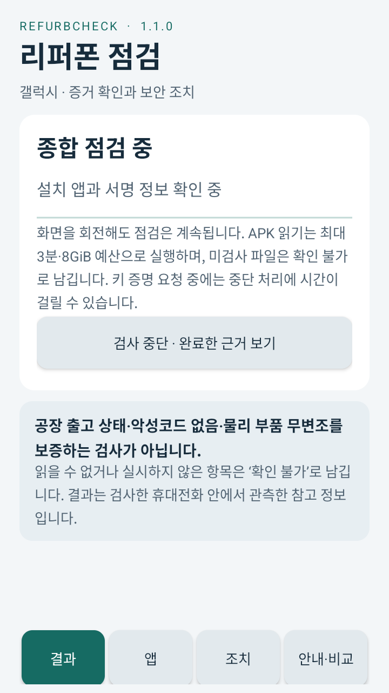

# Android 15 / API 35 검증 범위

상태: **일부 관측 후 에뮬레이터 시스템 ANR로 중단**. API35 전체 검증 통과로 해석하면 안 됩니다.

검사한 APK는 `RefurbCheck-1.1.0.apk`이며 SHA-256은
`f3286044ca028e66eef0510074ecbfcbe87a6a63dc8c80010b6ac223e124a8e7`입니다.

## 실제로 확인한 사항

1. Google 공식 AOSP Android 15/API35 x86_64 revision 2 이미지가 부팅됐고, `ro.build.version.sdk=35`를 확인했습니다. KVM 없는 소프트웨어 에뮬레이션에서 1회 시도, 586.04초가 걸렸습니다.
2. 위 해시의 동일한 APK를 설치했습니다.
3. 실제 RefurbCheck 1.1.0 화면에 자동으로 시작된 점검이 표시되는 것을 스크린샷으로 확인했습니다.

이미지는 [Google 공식 저장소 메타데이터](https://dl.google.com/android/repository/sys-img/android/sys-img2-1.xml)의
[x86_64-35_r02.zip](https://dl.google.com/android/repository/sys-img/android/x86_64-35_r02.zip)을 사용했고,
공식 크기와 SHA-1이 일치하는지 확인한 뒤 준비했습니다.

## 확인하지 못한 사항

- 자동 점검 완료 및 실제 보고서 내보내기
- 실제 보고서의 자기 APK SHA-256·파일 안정성
- API35에서의 최종 `UNKNOWN_PLATFORM` 서명 상태
- 공용 설정 화면에서 돌아온 뒤 재검사 동작

후속 UI 덤프에서 시스템 런처 **Quickstep의 응답 없음 대화상자**가 관측됐습니다. 수집한 로그에는 Android 시스템 구성요소의 ANR와 Bluetooth 중단이 포함됐으며, 해당 버퍼에서 RefurbCheck 자체의 크래시 또는 ANR는 발견하지 못했습니다. 이를 앱 전체의 정상 동작을 증명하는 결과로 확대하지 않습니다.

초기 `am start -W` 명령은 약 22초 뒤 timeout 상태를 보고했지만, 실제 앱의 자동 점검 화면은 표시됐습니다. 초기 `/sdcard`의 UI XML 읽기도 거부되어, shell 소유 임시 디렉터리에 새 덤프를 만들었고 여기서 시스템 ANR를 확인했습니다. 반복 대기나 VM 재시작 없이 정해진 범위에서 종료했으며, 드라이버는 정상 종료했습니다.

이 환경은 AOSP 에뮬레이터입니다. **실물 Galaxy, One UI, Knox, 제조사 펌웨어, 하드웨어 키 증명과 부품 검증은 수행하지 않았습니다.** API26에서 완료한 별도의 테스트 결과와 이 API35의 제한적인 관측을 구분해야 합니다.

구조화한 결과와 정확한 범위는 `api35-validation.json`에 있습니다. 앱 소스나 생산용 IOC 자료는 이 검사 때문에 변경하지 않았습니다.
