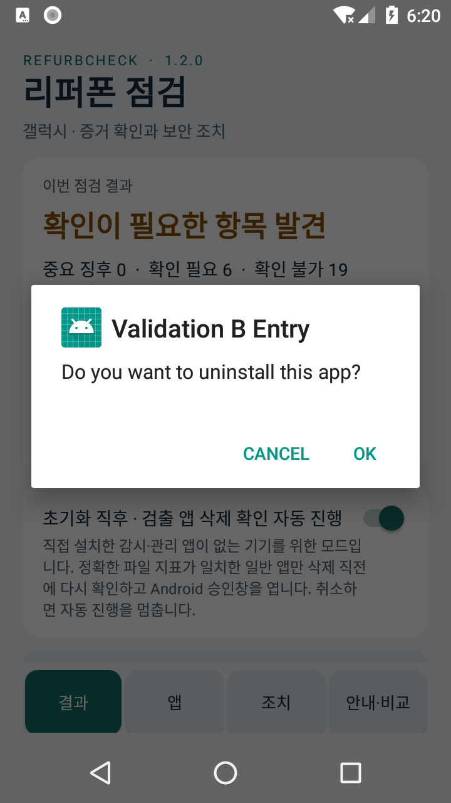
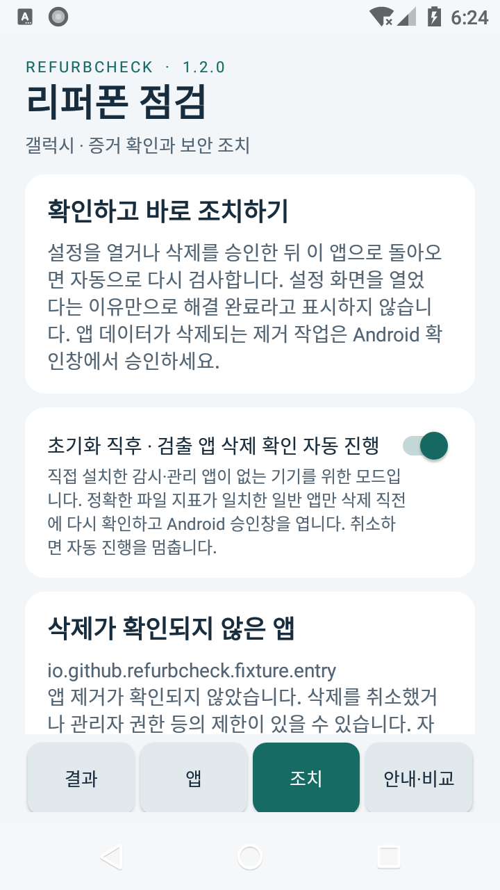
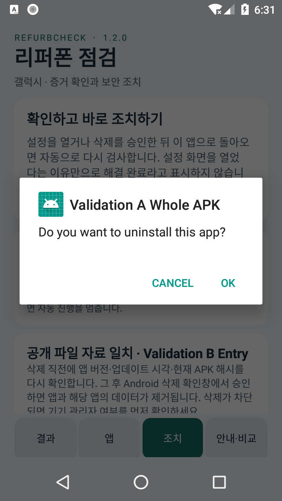
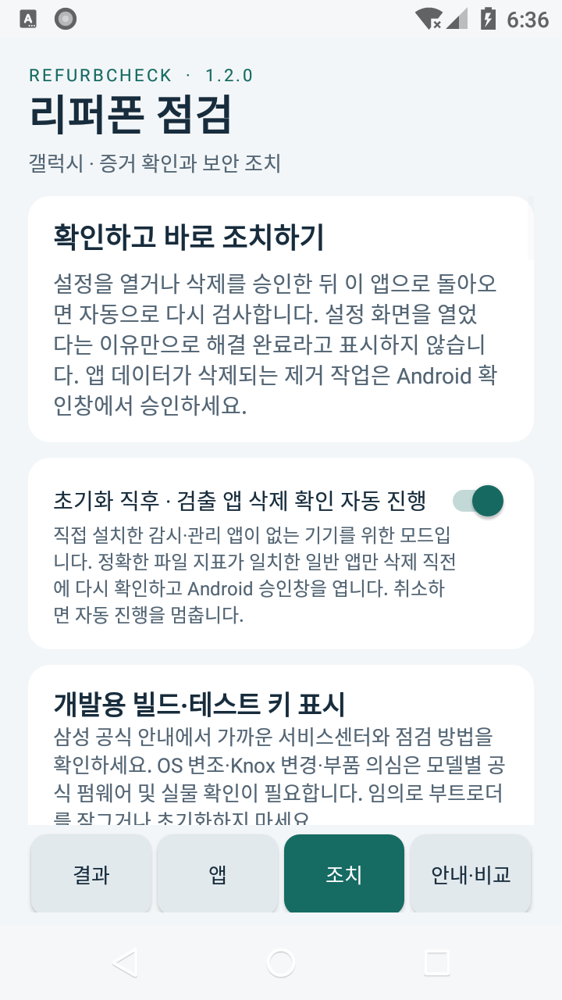

# v1.2 자동 검사·삭제 승인 흐름 실제 실행 검증

**결과: PASS.** Android API 26 x86 소프트웨어 에뮬레이터에서 별도 테스트 앱과 무해한 fixture 앱 2개로 자동 검사 → 삭제 직전 재검증 → Android 승인창 → 취소 시 중지 → 재점검 후 두 대상 순차 승인 → 최종 재검사 흐름을 실행했습니다. 서로 다른 검사 항목 31개가 통과했습니다.

JSON에는 총 38개의 판정 행이 있습니다. 선택적 로그 초기화가 실패한 뒤 **앱을 최초 실행하기 전에 준비 항목 7개를 다시 기록**했기 때문에, 고유 검사 31개와 반복 준비 기록 7개를 구분합니다. 추가 기능 시험 7개를 수행했다는 뜻이 아닙니다.

이 결과는 **에뮬레이터의 기능 경로 검증**입니다. 실제 악성코드 탐지율·갤럭시 실기기·하드웨어 무변조·악성코드 부재를 입증하지 않습니다. 실제 악성 샘플을 다운로드하거나 실행하지 않았습니다.

**환경 전체의 검사 범위는 별도로 봅니다.** 취소 후 검사에서는 87개 노출 패키지 중 78개가 직접 파일 검사 범위를 완료했고, 전체 파일 79개를 비교한 뒤 `TIME_LIMIT`로 종료했습니다. 두 fixture 각각은 `malwareInspectionComplete=true`였으며 정확 일치 근거를 모두 읽었습니다. 최종 재검사의 coverage 완료 값은 `true`, 중단 사유는 `없음`입니다. 부분 검사가 있는 결과의 일치 0건을 악성코드 없음으로 해석하지 않습니다. 실제 참조 자료를 넣은 production 앱의 검사는 별도 기록입니다.

## 시험 앱과 배포 앱 분리

테스트 앱은 `io.github.refurbcheck.validation` 패키지이며 `android:testOnly=true`, `debuggable=true`로 구성했습니다. Launcher Activity는 원래 클래스 `io.github.refurbcheck.MainActivity`를 그대로 사용했습니다. 배포 서명 키를 쓰지 않고 별도의 일회성 검증 서명 키를 사용했습니다. 디버그 속성은 기존 보고서 저장 UI가 만든 앱 전용 캐시를 `run-as`로 회수하기 위한 것입니다.

- 테스트 APK SHA-256: `7cc9372d09a676626469c7a9e8a777bc63ec228c6e953b40d7cee4faec01230f`
- 동작 코드 기준 생산 후보 APK SHA-256: `5d224edd86de73e22752e8acb9f32e3ff4f06b1388cb2d2c1566242cd66703ea`
- 최종 배포 후보 APK SHA-256: `addf557694e94e499f4409b764ccc0780629f137e1e6494ce5eb357e6d51be8c`
- 테스트 카탈로그: `fixture.synthetic` 2행만 참조, SHA-256 `4d358873685458c19594e9883c30f9e8764e3f1ef5a0560830e44a3ed7516701`.
- ClamAV 출처에만 적용되는 기존 허용목록 996행은 그대로이며 synthetic 출처를 무시하도록 만드는 허용목록이 아닙니다. 기존 MVT 검사 경로도 수정하지 않았습니다.

원래 생산 후보에서 복제할 때 생성 파일 `MalwareCatalog.java` 외의 Java 소스는 바이트 단위로 같았습니다. 최종 배포본은 안내·조치 탭의 **표시 문장 2개**만 추가로 다릅니다. [문구 변경 기록](display-wording-correction-v1.2.json)에 기록된 치환을 적용한 결과가 최종 `MainActivity.java`와 정확히 같고, 다른 소스·자산 45개는 원래 지문과 같음을 확인했습니다. 검사·대상 선정·preflight·삭제·취소·대기열 제어 로직은 달라지지 않았습니다.

최종 배포 APK의 모든 ZIP 항목을 읽어 synthetic 출처·fixture 이름·fixture 참조 해시·validation 패키지 문자열이 없고, 실제 카탈로그는 독립 자료 4개·15,645행이며 testOnly/debuggable 플래그가 없음을 확인했습니다. 테스트 APK·fixture APK·검증 서명 키는 배포 앱 자산이나 release 폴더에 복사하지 않았습니다.

## 무해한 시험 대상

두 fixture는 `hasCode=false`이며 DEX·네이티브 라이브러리·권한·Activity·Service·Receiver가 없습니다. 내부 항목 시험에는 설명용 평문 167바이트만 넣었습니다. 이름이 알려진 악성코드라는 뜻이 아니라 **시험 카탈로그에 의도적으로 등록한 알려진 파일**이라는 뜻입니다.

| 패키지 | 일치 범위 | 참조 크기(bytes) | 참조 SHA-256 |
|---|---|---:|---|
| `io.github.refurbcheck.fixture.whole` | APK 전체 | 8,538 | `54a8e885d9f7d52267e1778a2b08335d87dfe1f508f11cf9805513c27830d9ba` |
| `io.github.refurbcheck.fixture.entry` | 직접 ZIP 항목 | 167 | `a1770192076a4485eb5c120a20b9eaa67e00dc636890043afdc651f4bb28890a` |

동일한 실제 `MalwareEvidence` 클래스의 host 사전 검사에서도 전체 APK fixture는 `whole=1, entry=0`, 내부 항목 fixture는 `whole=0, entry=1`이었고 둘 다 ZIP 처리를 완료했으며 archive issue는 없었습니다.

## 관찰한 실제 순서

1. 테스트 앱을 실행했습니다. 앱 내부의 조치 버튼을 누르지 않아도 자동 검사가 시작됐고, 기본 자동 확인 모드가 켜져 있었습니다. 첫 대상은 `Validation B Entry`였습니다. Android 시스템 `com.android.packageinstaller`의 승인창이 열렸고 **승인 전 두 앱이 모두 설치된 상태**였습니다.
2. Android의 `CANCEL`을 눌렀습니다. 두 앱이 그대로 남았고 재검사가 끝난 뒤 ‘삭제가 확인되지 않은 앱’ 설명이 나타났습니다. 보고서를 검토·내보내는 동안 다음 승인창을 열지 않았습니다. 조치 기록에는 `PACKAGE_STILL_PRESENT`가 남았으며 `SCREEN_OPENED`는 1회뿐이었습니다.
3. 기존 ‘결과 JSON 저장’ UI에서 실제 보고서를 생성했습니다. 테스트 데이터 2행이 정상 로드됐고 두 fixture의 범위·참조 해시·정확한 크기·바깥 APK 해시가 예상과 일치했습니다. 전체 파일 일치와 내부 항목 일치가 구분되어 기록됐습니다.
4. ‘다시 점검하고 조치 계속’을 눌렀습니다. 새 검사를 수행하고 Android 승인창을 다시 열었습니다. 두 대상은 한 번에 하나씩 표시됐으며, 각 대상의 `OK`를 누른 뒤 패키지가 실제로 사라졌는지 Package Manager로 확인했습니다.
5. 마지막 대상 처리 후 예산 제한이 있는 자동 재검사가 종료했습니다. 새 reportId의 보고서에서 두 fixture가 inventory에서 사라지고 synthetic 일치 앱 수가 **0**이었습니다. 로그에는 최초 취소 1회와 승인 후 `PACKAGE_NOT_PRESENT` 2회, `AUTO_REMOVAL_PREFLIGHT`·`SCREEN_OPENED` 각 3회가 남았습니다. `silentRemoval=false`, `systemRemovalApprovalRequired=true`도 확인했습니다. 전체 coverage 완료 여부는 위에 따로 기록했습니다.

삭제 직전 재검증은 원래 `RemediationController`와 `MalwareRemovalVerifier` 코드를 통과해야만 `SCREEN_OPENED`로 이어지는 실제 경로입니다. 공개 JSON을 임의로 가져와 삭제를 지시하거나 ADB로 fixture를 직접 지우는 경로는 사용하지 않았습니다. 시험 종료 후 별도 validation 앱을 정리하는 ADB 제거는 이 기능 시험과 구분합니다.

최종 앱 검사에서 확인된 패키지 수: **85개**, synthetic 일치 앱 **0개**. 이 숫자는 시험 환경의 관찰값이며 실제 휴대폰의 앱 수·검사 성능을 예측하지 않습니다.

## 화면 증거

아래 화면은 전부 **무해한 synthetic 데이터로 실행한 별도 테스트 앱**입니다.

### 자동으로 열린 첫 Android 확인창

### 취소 후 자동 진행 중지

### 두 번째 대상의 순차 승인창

### 마지막 제거와 재검사 뒤 조치 화면

최종 수치인 APK 85개·내부 파일 31,210개·일치 앱 0개는 [실제 결과탭 UI XML](test-only-remediation-v1.2/07-final-result.xml)과 [실제 내보낸 보고서](test-only-remediation-v1.2/final-report.json)에서 확인했습니다. `07-final-result.png`는 결과 탭 전환이 그려지기 직전에 찍혀 조치 탭을 보여 주므로, 숫자를 보여 주는 화면이라고 제시하지 않습니다. 본문에는 안정된 마지막 조치 화면을 사용합니다.

## 원본 자료와 실행상의 한계

[검사 결과 JSON](test-only-remediation-v1.2.json)에 항목별 판정·시간·fixture 지문·조치 기록·최종 배포 격리 검증·첨부물 SHA-256을 기록했습니다. [취소 뒤 실제 내보낸 보고서](test-only-remediation-v1.2/after-cancel-report.json), [마지막 실제 내보낸 보고서](test-only-remediation-v1.2/final-report.json), [최종 배포 manifest](test-only-remediation-v1.2/production-final-manifest.txt) 및 화면별 UI XML도 보존했습니다.

재현에 필요한 소스는 [tests/validation-fixtures-v1.2](../tests/validation-fixtures-v1.2/README.md)에 보존했습니다. 테스트 APK·개인 서명 키·암호 파일을 포함하지 않으며, 새 fixture 서명 키를 만들면 실제 해시를 다시 계산하여 테스트 카탈로그를 생성합니다. 공개 재현용 생성기는 본 세션의 암호 리터럴을 제거하고 난수 암호를 생성하도록 바꾼 부분만 별도 지문·설명으로 기록했습니다.

준비 중 선택적 `adb logcat -c`가 거부되어 로그를 지우지 않고 계속했습니다. 화면 전환 중 UIAutomator가 exit 0과 함께 null root를 반환한 읽기 실패도 한 차례 있어 UI 읽기에 제한된 재시도를 넣었습니다. 어느 경우에도 앱 제어 코드를 바꾸거나 실패한 UI 조작을 무조건 반복하지 않았습니다. 원래 진단은 JSON의 `harnessNotes`에 남겼습니다.

실물 갤럭시·최신 Android 전체·관리자 권한으로 제거가 막힌 앱·업무 프로필·실제 악성 표본 집합의 재현율은 이번 시험 범위 밖입니다. production의 실제 참조 자료로 실행한 검사 기록과 이 synthetic 양성 경로 시험은 별도 검증입니다.
