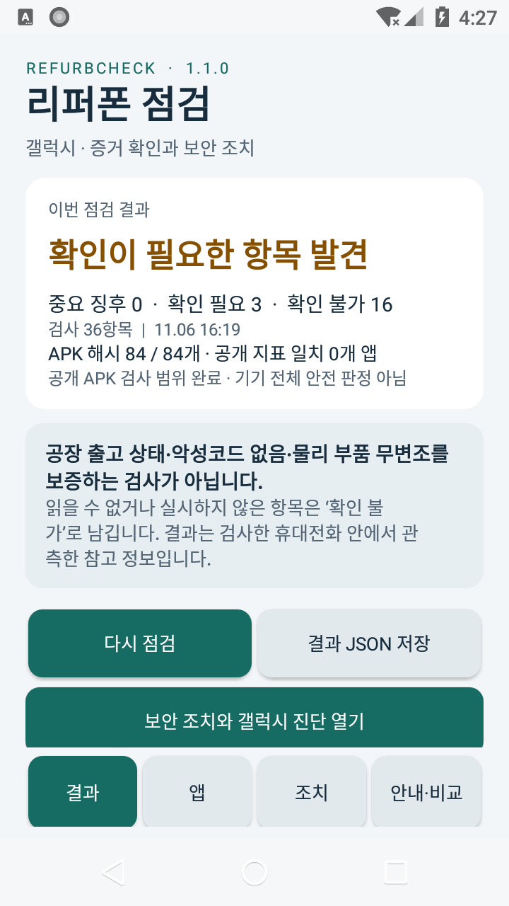
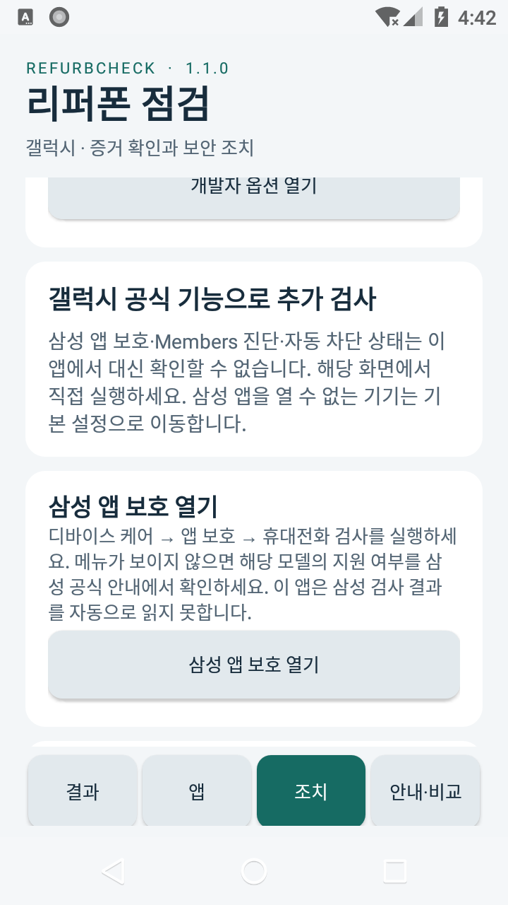
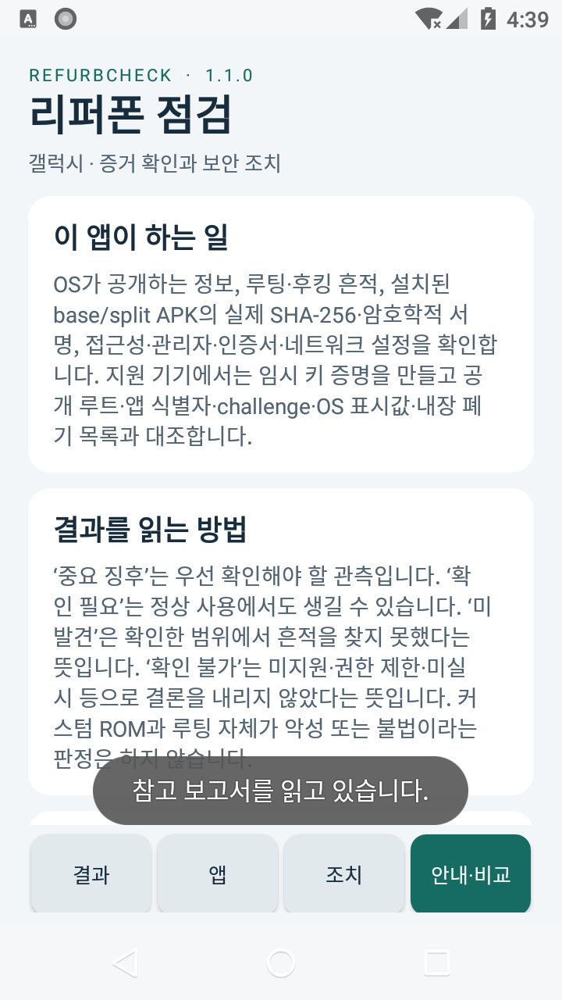
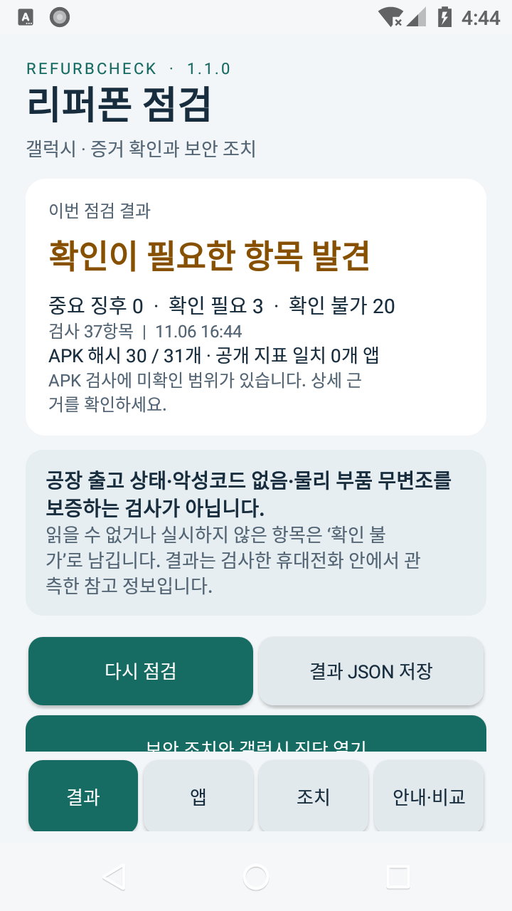

# RefurbCheck 1.1.0 — API26 실제 런타임 검증

검증일: 2026-11-06. 대상 APK SHA-256:

`f3286044ca028e66eef0510074ecbfcbe87a6a63dc8c80010b6ac223e124a8e7`

환경은 Android 8.0 / API26 / x86 AOSP 에뮬레이터이며 CPU 소프트웨어 에뮬레이션과 SwiftShader, 720×1280 화면을 사용했다. 물리 Galaxy 또는 API35 실행 결과로 해석하지 않는다. API35 검증은 별도 기록이 필요하다.

## 확인한 결과

| 항목 | 실제 관측 |
| --- | --- |
| APK 설치·최초 실행 | 서명된 versionCode 2 / versionName 1.1.0 설치, 자동 검사 완료, 결과·앱·조치·안내 비교 4탭 표시 |
| 실제 Android ART의 APK 엔진 시험 | `app_process`에서 30개 시나리오, 51개 assertion, 0개 실패. 정상 APK, 1바이트 변조 APK, 취소·크기·시간 예산·IOC 파서 등 포함 |
| 앱에 통합된 APK 검사 | 84개 노출 패키지, 84개 base APK의 해시와 서명 확인. invalid 0, signer mismatch 0, signature unknown 0 |
| 자기 APK 검증 | 설치된 base.apk 해시가 위 릴리스 해시와 일치. 서명 `VERIFIED`, 암호 검증 true, 서명자 메타데이터 일치 true. v2/v3 검증 및 엔진 경고를 함께 기록 |
| 실제 파일 저장 | Android 문서 선택기에서 Downloads에 JSON 저장 후 파일을 회수하여 UTF-8 JSON과 `refurbcheck-report-v2` 스키마 확인 |
| 실제 파일 가져오기 | 저장한 JSON을 문서 선택기에서 다시 선택하여 참고 보고서 비교 화면까지 확인 |
| 삼성 앱 부재 시 연결 | AOSP에는 Device Care가 없어 기본 Settings 화면으로 연결됨 |
| 조치 후 자동 재검사 | 조치 직전과 복귀 후 보고서 ID가 달라짐. `SCREEN_OPENED`, `SCREEN_RETURNED`, `VERIFICATION_UNAVAILABLE`을 구분하여 기록 |
| 검사 중단 | `cancelRequested=true`, `stopReason=CANCELLED`; hash/signature/IOC/전체 APK 검사 complete는 모두 false |
| 중단 시 미검사 범위 | 84개 패키지 중 30개 전체 해시 확인, 31개 발견 파일 중 30개 해시/서명 확인, 1개 파일 unknown, 53개는 이후 메타데이터 수집을 완료하지 못함. 총 54개 패키지의 APK 검사가 미완료로 남음 |
| 전체 안전 판정 방지 | 완주·중단 보고서 모두 공장 원본·악성코드 부재·물리 하드웨어·필수 전체 영역 인증 플래그 false |
| 문서 선택 취소 | 취소 후 기존 검사 결과 유지 |
| 앱 오류 | 보존한 UI 검사 로그에서 RefurbCheck의 FATAL EXCEPTION 또는 ANR 미발견 |

최종 [UI 검사 기록](ui-smoke-v1.1.json)은 30개 확인 항목이 통과했다. [통합 검사 관측값](emulator-api26-observations-v1.1.json)에는 완주/중단 coverage, 자기 APK 근거와 조치 이력이 있다. 엔진 시험의 원문 출력은 [ART 로그](apksig-art-api26-v1.1.txt), 입력 해시와 범위는 [ART 메타데이터](apksig-art-api26-v1.1.json)에 남겼다.

## 시스템 제거 시험의 별도 범위

권한·실행 코드가 없는 `io.github.refurbcheck.fixture.removable` 테스트 APK를 만들고 Android 제거 확인창의 CANCEL 후 패키지 유지, OK 후 패키지 제거를 확인했다. 이 창은 adb의 공개 Intent로 열었다. 따라서 **앱 내부 IOC 일치 경로의 삭제 버튼이나 해당 앱 호출 권한까지 종단 검증한 것은 아니다.** 출하 IOC 목록은 바꾸지 않았고 악성 앱을 설치하지 않았다. [별도 기록](system-uninstall-api26-v1.1.json)에 이 범위를 명시했다.

## 미검증과 환경 한계

- 물리 Galaxy, 제조사 Knox 서버 증명, 삼성 앱 보호의 실제 검사 결과는 미검증이다. AOSP에서 공식 앱 부재 시 Settings 연결만 확인했다.
- 이 이미지의 84개 설치 패키지는 모두 base APK였다. 실제 split APK 설치 패키지에 대한 통합 동작은 이 실행으로 검증하지 않았다.
- 외부 문서 선택기가 열려 있는 동안 앱 프로세스를 종료한 뒤 저장을 완료하는 동작은 이번 런타임 시험에서 미실시다. 캐시 구현이 있다는 사실을 실행 검증으로 바꾸지 않는다.
- API26 결과를 API35 또는 더 최신 Android의 서명 정책 검증으로 확대하지 않는다. 앱 보고서는 엔진의 최대 모델 API33을 별도로 기록한다.
- 처음 에뮬레이터를 띄운 뒤 System UI 자체 ANR이 한 번 발생하여 Wait로 복구했다. RefurbCheck 1.1 설치 전 사건이며 앱 ANR로 분류하지 않았다.
- 테스트 파일 큐에서 완료 요청이 다시 보이며 중복 UI 입력이 실행되는 문제가 발견됐다. 드라이버에 완료 ID와 실행 claim 원장을 추가하고 동일 AVD 데이터로 재시작했다. 저장한 JSON 근거를 보존한 뒤 가져오기·조치 복귀·중단은 수정된 드라이버로 다시 검증했다. 앱 소스는 이 과정에서 변경하지 않았다.

## 화면 증거

